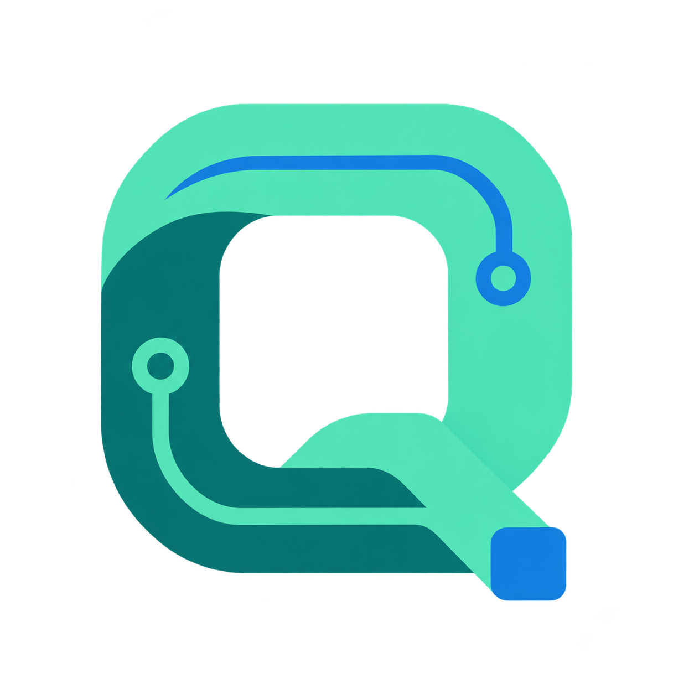

<div align="center">



# 🏫 CampusTwin AI

### Menos correos. Más claridad para reservar.

**QuantumByte · Hackathon ENEISOFT XVI 2026**

[](https://campustwin-ai-demo.onrender.com)


**Plataforma experimental de consulta de ambientes, reservas asistidas y ocupación observada mediante visión artificial.**

[🌐 Abrir demostración](https://campustwin-ai-demo.onrender.com) · [📐 Arquitectura](docs/ARCHITECTURE.md) · [🧪 Pruebas](docs/QA_REPORT.md) · [🎤 Guion de presentación](docs/DEMO.md)

</div>

---

> [!IMPORTANT]
> **Prototipo académico independiente.** CampusTwin AI no es una plataforma oficial ni un canal institucional de reservas de la Universidad Nacional Mayor de San Marcos. Los ambientes y las reservas son ficticios. La selección de perfiles es demostrativa y **no equivale a autenticación ni permisos administrativos**.

## ✨ Vista del proyecto


**Capturas reales proporcionadas por el equipo:** pantalla de selección de perfiles y vista del asistente de IA. Están preparadas para incorporarse a `docs/screenshots/`; las imágenes anteriores no deben presentarse como capturas reales hasta que estén efectivamente publicadas en GitHub.

## 🚀 Funcionalidades

| Módulo | ¿Qué permite? | Tecnología |
| --- | --- | --- |
| 🗺️ **Catálogo de ambientes** | Consultar espacios y disponibilidad por fecha y horario | React + FastAPI |
| 📅 **Reservas** | Seleccionar un ambiente y confirmar una reserva ficticia | FastAPI + SQLite |
| 🧑‍💼 **Secretaría** | Consultar la agenda desde un perfil demostrativo | React |
| 🤖 **Asistente de IA** | Interpretar necesidades y proponer alternativas que requieren confirmación humana | DeepSeek Flash |
| 📷 **Ocupación observada** | Mostrar conteos anónimos recibidos desde una cámara externa | YOLO11n + API |
| ☁️ **Demostración pública** | Ejecutar frontend y backend desde un mismo servicio | Docker + Render Free |

## 🧩 Arquitectura

```text
                  Navegador web (React + Vite)
                             |
                            HTTPS
                             |
                   Render Free (FastAPI)
                      /      |       \
                     /       |        \
             SQLite /tmp   DeepSeek    POST /api/telemetry
             (efímero)    (propuestas)       ^
                                            |
                                Agente YOLO11n local
                                (webcam de David)
```

La cámara **no se ejecuta en Render**. El agente externo envía conteos, estado y marcas de tiempo; no transmite imágenes ni video. Las mediciones caducan aproximadamente a los **15 segundos**. Sin lectura vigente, la ocupación se muestra como **desconocida**, no como cero.

## 💻 Instalación local

Requisitos: Python 3.12, Node.js compatible con `frontend/package-lock.json` y npm.

```powershell
git clone https://github.com/LE0ST/campus-twin-ai.git
cd campus-twin-ai
py -3.12 -m venv .venv
.venv\Scripts\python.exe -m pip install -r requirements.txt
.venv\Scripts\python.exe -m uvicorn backend.main:app --host 127.0.0.1 --port 8000
```

En una segunda terminal:

```powershell
cd frontend
npm ci
npm run dev
```

Para servir el frontend desde FastAPI: ejecutar `npm run build` en `frontend/` y después iniciar el backend desde la raíz del repositorio.

## 📷 Cámara y visión artificial

En el equipo conectado a la cámara, instalar las dependencias y pesos del modelo según [la guía del módulo de visión](vision/README.md). En PowerShell:

```powershell
$env:VISION_INGEST_TOKEN = Read-Host "Token de ingesta"
python vision/main.py --backend https://campustwin-ai-demo.onrender.com --camera 1 --device cpu --show
```

El token debe coincidir con el valor configurado en Render. Una medición aceptada responde con **HTTP 202**; **401** indica token incorrecto. Solo usar `--device cuda:0` si PyTorch reconoce CUDA. El equipo observó detecciones reales por CPU y, tras corregir el token, confirmó recepción de telemetría en Render. Esto no constituye una medición certificada de precisión del modelo.

## 🔐 Seguridad y límites

- **Sin credenciales en Git:** `DEEPSEEK_API_KEY` y `VISION_INGEST_TOKEN` son secretos del servidor; nunca deben incluirse en capturas, Vite ni commits.
- **Reservas de demostración:** no hay autenticación institucional ni autorización administrativa real.
- **Persistencia limitada:** Render Free usa `CAMPUSTWIN_DB=/tmp/campustwin-demo.db`, sin disco persistente. Las reservas pueden perderse tras reinicios o nuevos despliegues.
- **IA supervisada:** el asistente propone, pero no registra reservas sin confirmación.
- **Privacidad:** el módulo de visión transmite únicamente telemetría agregada; no almacena imágenes.

## 🧪 Pruebas

```powershell
.venv\Scripts\python.exe -m pytest tests -q
cd frontend
npm test
npm run lint
npm run build
```

En la integración se comunicaron **75 pruebas backend** y **23 pruebas frontend** correctas. Terra verificó Docker y persistencia en un **volumen local**, no en Render Free. El despliegue público del commit `d01687d` se verificó en estado **Live**; las posteriores modificaciones del README no cambian el comportamiento de la aplicación. Para distinguir pruebas automatizadas, reportes del equipo y pendientes, consultar el [informe de calidad](docs/QA_REPORT.md).

## 📚 Documentación

| Documento | Contenido |
| --- | --- |
| [Arquitectura](docs/ARCHITECTURE.md) | Componentes, flujo de datos y responsabilidades |
| [Guion de demostración](docs/DEMO.md) | Recorrido de tres minutos |
| [Informe de pruebas](docs/QA_REPORT.md) | Evidencias, resultados y limitaciones |
| [Trazabilidad](docs/TRACEABILITY.md) | Requisitos e implementación |
| [Despliegue en Render](docs/RENDER_DEPLOY.md) | Variables, servicio gratuito y validaciones |
| [Validación Docker](docs/DOCKER_VALIDATION.md) | Pruebas locales de infraestructura |
| [Módulo de visión](vision/README.md) | Cámara, ejecución y privacidad |
| [Frontend](frontend/README.md) | Instalación y pruebas de React |

## 👥 Equipo QuantumByte

| Integrante | Responsabilidad |
| --- | --- |
| **Leonardo** | Backend, integración y coordinación |
| **Marco** | Frontend y experiencia de usuario |
| **David** | Visión artificial y telemetría |

Desarrollado como prototipo académico independiente para **ENEISOFT XVI 2026**. No implica patrocinio ni respaldo institucional.
